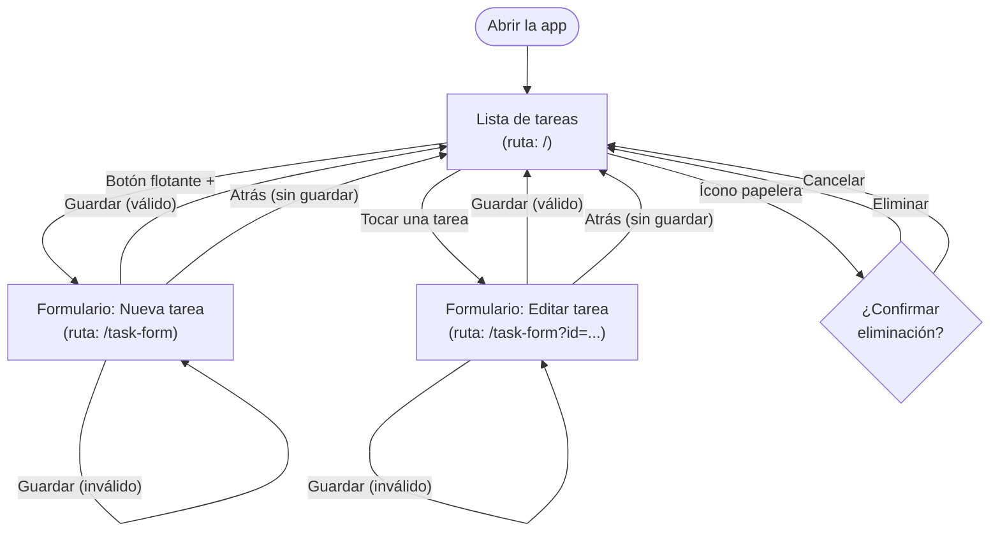

# Brief: App de Lista de Tareas (To-Do List)

> Evaluación 1 · Desarrollo de Aplicaciones Móviles
> Estado: planificación de alto nivel. Este documento **no contiene código**.

## 1. Objetivo y usuario objetivo

**Objetivo.** Construir una app móvil sencilla para registrar y gestionar tareas personales. Cada tarea tiene un título y una descripción. La app permite **listar, agregar, editar y eliminar** tareas.

**Usuario objetivo.** Una persona que necesita anotar y revisar sus pendientes del día a día, sin conocimientos técnicos y sin cuenta de usuario. Usa la app con una sola mano, en un celular Android.

**Objetivo académico.** Demostrar:

- Una interfaz clara (jerarquía visual, contraste, balance).
- Componentes comunes bien implementados: botones, formularios, listas y navegación.
- Uso correcto de los conceptos y patrones de Expo y React Native, explicados con palabras simples.

## 2. Alcance

### Dentro del MVP

- Ver la lista de tareas.
- Agregar una tarea (título y descripción obligatorios).
- Editar una tarea existente.
- Eliminar una tarea, con confirmación previa.
- Limpiar el formulario después de guardar.
- Mostrar un estado de lista vacía y mensajes de error de validación.
- Evitar que el teclado tape los campos y el botón «Guardar» del formulario.
- Guardar los datos **solo en memoria**: se pierden al cerrar la app.
- Interfaz en español.

### Fuera de alcance (unidades futuras)

- Almacenamiento local persistente (por ejemplo, SQLite o AsyncStorage).
- Autenticación y cuentas de usuario.
- Consumo de APIs o sincronización con un servidor.
- Cualquier otra función no listada arriba (ver «Sugerencias» al final).

## 3. Pantallas y flujo de navegación

Se usa **navegación stack** con Expo Router. Una pantalla se apila sobre la anterior, y «volver» la quita de la pila.

| Pantalla | Ruta | Título en la barra | Propósito |
|---|---|---|---|
| Lista de tareas | `/` | «Mis tareas» | Ver todas las tareas, abrir una para editarla, eliminarla o ir a crear una nueva |
| Formulario de tarea | `/task-form` | «Nueva tarea» o «Editar tarea» | Una sola pantalla que sirve para **agregar** y **editar** |

**Cómo sabe el formulario si agrega o edita.** Recibe un parámetro de ruta opcional `id`:

- Sin `id`: modo **agregar**. Campos vacíos y título «Nueva tarea».
- Con `id`: modo **editar**. Campos cargados con los datos de esa tarea y título «Editar tarea».

**Dónde vive el estado.** Las dos pantallas necesitan ver la misma lista de tareas, así que el estado se guarda **por encima de ambas**, en un proveedor de contexto de React (React Context) colocado en el layout raíz. Es el patrón de «elevar el estado». Cuando se guarde algo más adelante en disco, solo cambiará ese proveedor.

**Hacia dónde lleva «volver».**

- **Después de guardar** (agregar o editar): vuelve a la **Lista de tareas**, que ya muestra el cambio.
- **Botón atrás del sistema o de la barra**, sin guardar: vuelve a la lista y descarta lo escrito.
- **Después de eliminar**: no hay cambio de pantalla; el ítem desaparece de la lista.

## 4. Modelo de datos

Una tarea es un objeto con tres campos:

| Campo | Tipo | Obligatorio | Descripción |
|---|---|---|---|
| `id` | `string` | Sí (lo genera la app) | Identificador único. No lo escribe el usuario. Sirve para encontrar la tarea al editar o eliminar, y como `key` en la lista |
| `title` | `string` | Sí | Título corto de la tarea |
| `description` | `string` | Sí | Detalle de la tarea |

**Reglas del modelo:**

- `title` y `description` no pueden estar vacíos ni contener solo espacios. Se guardan sin espacios sobrantes al inicio y al final.
- El `id` no cambia nunca, ni siquiera al editar.
- La lista completa es un arreglo de tareas, guardado en el estado en memoria.
- No hay límite de largo en los campos en este MVP.

## 5. Flujos principales

### 5.1 Agregar una tarea

1. En la lista, la persona toca el **botón flotante «+»**.
2. Se abre el formulario «Nueva tarea» con ambos campos vacíos.
3. Escribe el título y la descripción, y toca **«Guardar»**.
4. La app valida:
   - **Si hay errores**: se queda en el formulario, muestra el error bajo cada campo con problema y **conserva** lo escrito.
   - **Si es válido**: crea la tarea con un `id` nuevo, la agrega a la lista, **limpia el formulario** y vuelve a la lista.
5. La nueva tarea aparece **al principio** de la lista.

### 5.2 Editar una tarea

1. En la lista, la persona **toca una tarea**.
2. Se abre el formulario «Editar tarea» con título y descripción cargados. Si el `id` recibido no corresponde a ninguna tarea, la app vuelve a la lista.
3. Modifica los campos y toca **«Guardar»**.
4. La app valida con las mismas reglas que al agregar:
   - **Si hay errores**: se queda en el formulario con los mensajes.
   - **Si es válido**: actualiza esa tarea (mismo `id`), limpia el formulario y vuelve a la lista.
5. La lista muestra la tarea con los datos nuevos, en la misma posición.

### 5.3 Eliminar una tarea (con confirmación)

1. En la lista, la persona toca el **ícono de papelera** de una tarea.
2. Aparece un diálogo de confirmación, por ejemplo: «¿Eliminar esta tarea? Esta acción no se puede deshacer», con los botones **«Cancelar»** y **«Eliminar»**.
3. Según lo que elija:
   - **«Eliminar»**: la tarea se quita de la lista.
   - **«Cancelar»** (o tocar fuera del diálogo): no pasa nada y la tarea sigue ahí.
4. Si era la última tarea, la lista muestra el estado vacío.

## 6. Estados de la interfaz

| Estado | Cuándo ocurre | Qué ve la persona |
|---|---|---|
| **Lista vacía** | No hay tareas (al abrir la app o al borrar la última) | Un mensaje amigable, por ejemplo «Aún no tienes tareas», con una indicación de cómo empezar («Toca + para agregar una»). El botón «+» sigue visible |
| **Lista con tareas** | Hay una o más tareas | Cada tarea muestra su título y su descripción, y un ícono de papelera |
| **Error: título vacío** | Se intenta guardar sin título (o solo espacios) | Mensaje bajo el campo, por ejemplo «El título es obligatorio» |
| **Error: descripción vacía** | Se intenta guardar sin descripción (o solo espacios) | Mensaje bajo el campo, por ejemplo «La descripción es obligatoria» |
| **Ambos campos inválidos** | Se intenta guardar con los dos vacíos | Se muestran los dos mensajes a la vez |
| **Confirmación de eliminación** | Se toca la papelera | Diálogo con «Cancelar» y «Eliminar» |
| **Guardado correcto** | Se guarda una tarea válida | El formulario se limpia, la app vuelve a la lista y el cambio es visible allí |

**Reglas sobre los errores:**

- Los mensajes aparecen **al intentar guardar**, no mientras la persona escribe por primera vez.
- Un mensaje desaparece cuando el campo pasa a ser válido.
- Un formulario con errores **no** crea ni modifica ninguna tarea.

## 7. Criterios de aceptación

Cada criterio se puede comprobar a mano en el celular.

### 7.1 Listar tareas

- [ ] **CA-L1.** Al abrir la app, la pantalla «Mis tareas» muestra todas las tareas existentes.
- [ ] **CA-L2.** Cada tarea muestra su título y su descripción.
- [ ] **CA-L3.** Si no hay tareas, se muestra el mensaje de lista vacía y no una pantalla en blanco.
- [ ] **CA-L4.** Si hay muchas tareas, la lista se puede desplazar y se ven todas.
- [ ] **CA-L5.** Al cerrar y volver a abrir la app, la lista está vacía (los datos solo viven en memoria).

### 7.2 Agregar tarea

- [ ] **CA-A1.** Al tocar «+», se abre el formulario «Nueva tarea» con los dos campos vacíos.
- [ ] **CA-A2.** Con título y descripción válidos, al guardar la tarea aparece al principio de la lista.
- [ ] **CA-A3.** Después de guardar, la app vuelve a la lista.
- [ ] **CA-A4.** Al volver a tocar «+» después de guardar, el formulario está vacío.
- [ ] **CA-A5.** Con el título vacío o solo espacios, no se guarda y aparece «El título es obligatorio».
- [ ] **CA-A6.** Con la descripción vacía o solo espacios, no se guarda y aparece «La descripción es obligatoria».
- [ ] **CA-A7.** Si ambos campos están vacíos, aparecen los dos mensajes a la vez.
- [ ] **CA-A8.** Si hay un error de validación, el texto ya escrito en el otro campo no se borra.
- [ ] **CA-A9.** Al usar atrás sin guardar, no se crea ninguna tarea.

### 7.3 Editar tarea

- [ ] **CA-E1.** Al tocar una tarea, se abre «Editar tarea» con el título y la descripción actuales.
- [ ] **CA-E2.** Al cambiar los datos y guardar, la lista muestra los datos nuevos de esa tarea.
- [ ] **CA-E3.** Editar una tarea no modifica ni duplica las demás, y no cambia el orden de la lista.
- [ ] **CA-E4.** No se puede guardar una edición con título o descripción vacíos; aparecen los mismos mensajes que al agregar.
- [ ] **CA-E5.** Al usar atrás sin guardar, la tarea queda con sus datos originales.
- [ ] **CA-E6.** Después de guardar la edición, la app vuelve a la lista.

### 7.4 Eliminar tarea

- [ ] **CA-D1.** Cada tarea de la lista tiene un ícono de papelera visible.
- [ ] **CA-D2.** Al tocar la papelera, aparece un diálogo de confirmación; la tarea **no** se elimina todavía.
- [ ] **CA-D3.** Al elegir «Eliminar», la tarea desaparece de la lista y las demás permanecen.
- [ ] **CA-D4.** Al elegir «Cancelar», la tarea sigue en la lista sin cambios.
- [ ] **CA-D5.** Al eliminar la última tarea, se muestra el estado de lista vacía.
- [ ] **CA-D6.** Tocar la papelera abre solo el diálogo de confirmación; no abre el formulario de edición.

### 7.5 Generales

- [ ] **CA-G1.** Todos los textos que ve la persona están en español.
- [ ] **CA-G2.** La app funciona en un celular Android con Expo Go (SDK 57), sin librerías que requieran código nativo adicional.
- [ ] **CA-G3.** La navegación es de tipo stack: el botón atrás vuelve a la pantalla anterior.
- [ ] **CA-G4.** `npx tsc --noEmit` y `npx expo lint` terminan sin errores.
- [ ] **CA-G5.** En el formulario, con el teclado abierto, el teclado no tapa los campos ni el botón «Guardar».
- [ ] **CA-G6.** Los botones que solo tienen ícono («+» y papelera) tienen etiqueta de accesibilidad, y todos los elementos tocables miden al menos 48 dp.

## 8. Supuestos y decisiones

### Supuestos

1. La app se prueba en Android con Expo Go (SDK 57); no se hace una compilación nativa propia.
2. No hay límite de largo en título ni descripción.
3. Las tareas nuevas se muestran **primero** (arriba de la lista).
4. Se permiten tareas con el mismo título; lo que las distingue es el `id`.
5. El `id` lo genera la app.
6. El estado compartido se hace con React Context, sin librerías de estado externas.
7. Los textos de la interfaz están en español; el código, los archivos y las variables están en inglés.
8. El diseño visual detallado (colores, tipografía, espaciado) **no** va en este brief. Se documentará aparte en `docs/design.md`.

### Decisiones

1. **Confirmación al guardar.** No hay aviso «Tarea guardada» en el MVP: la confirmación es ver el cambio en la lista.
2. **Cambios sin guardar.** Al tocar atrás con cambios sin guardar, se descartan sin preguntar.
3. **Generación del `id`.** Se genera con `Crypto.randomUUID()` de `expo-crypto` (ver `docs/stack.md`).
4. **Tarea inexistente.** Si el formulario recibe un `id` que no existe, vuelve a la lista.
5. **Orden de la lista.** Las tareas nuevas se muestran primero (ver supuesto 3).
6. **Teclado.** El formulario debe evitar que el teclado tape los campos y el botón «Guardar». Es un requisito del MVP.

## Sugerencias (fuera de alcance, para considerar más adelante)

Estas ideas **no forman parte del MVP**.

- Marcar tareas como completadas.
- Modo oscuro.
- Guardar las tareas en el dispositivo para que no se pierdan al cerrar la app (por ejemplo con `expo-sqlite`).
