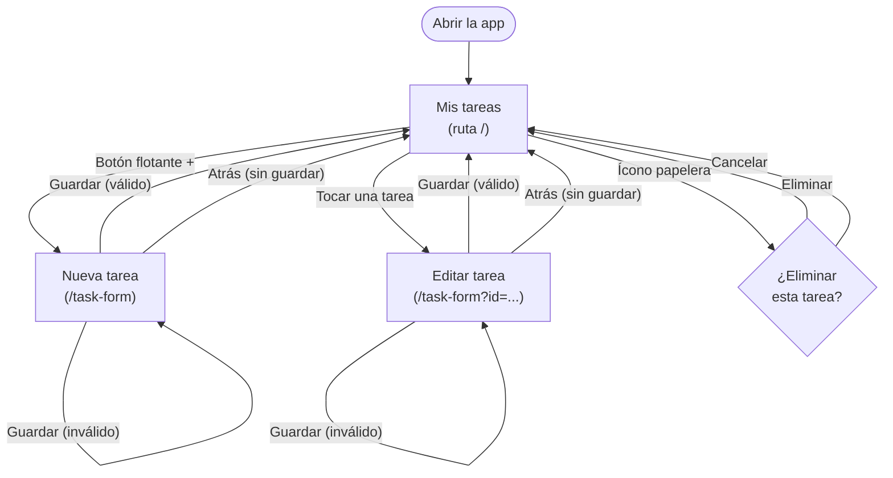
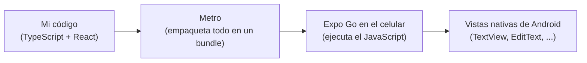
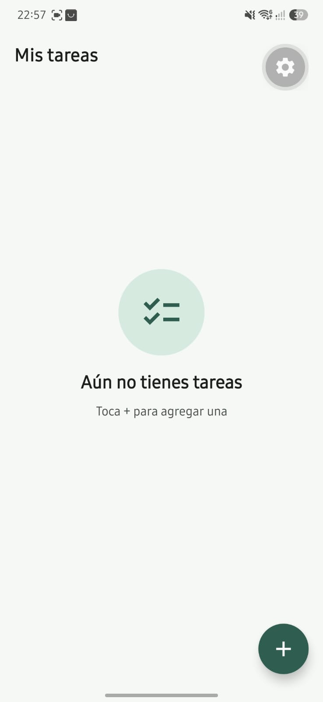
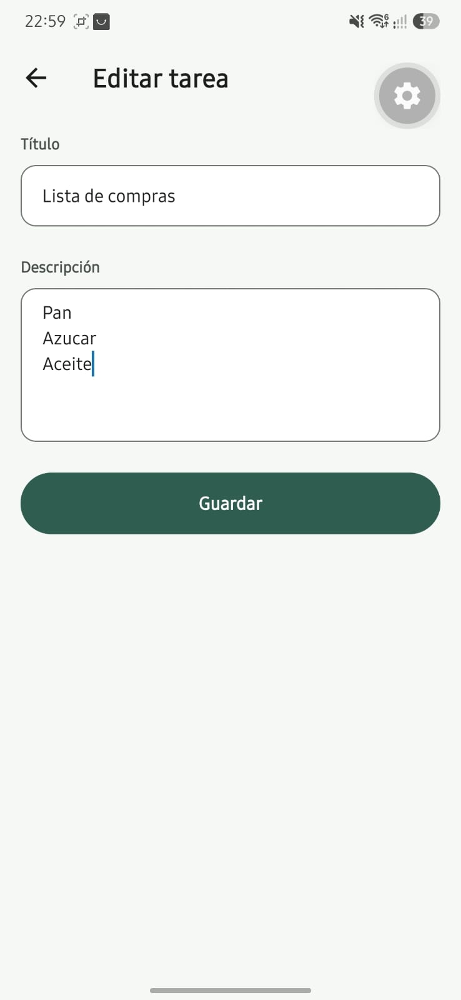
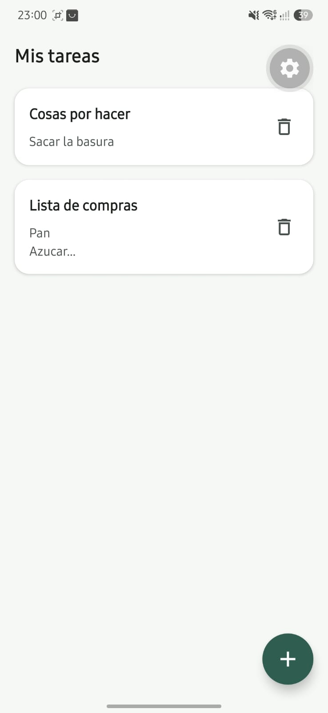
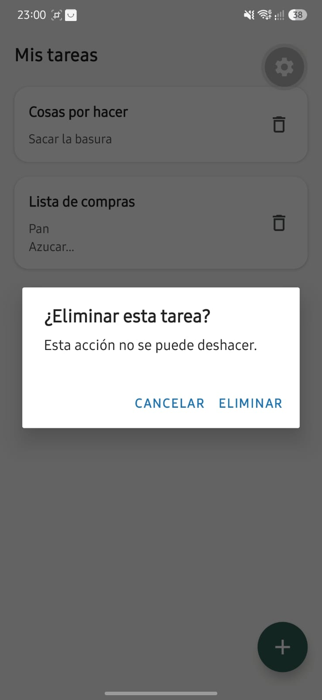

> **Informe original de la Evaluación 1** (rama `main`, commit `387dae3`). Se conserva tal cual, con los enlaces ajustados a esta carpeta. El estado actual de la app está en el [README](../README.md) y el registro de avances en [avances-eva2.md](avances-eva2.md).

<p align="center">
  
</p>

# Evaluación 1 – App de Lista de Tareas

**Desarrollo de Aplicaciones Móviles**
Instituto Profesional San Sebastián

| | |
|---|---|
| **Profesor** | Boris Belmar Muñoz |
| **Alumno** | Andrés Antonio Orellana Narváez |
| **Sección** | 51 |


---

## ÍNDICE

1. [Portada](#evaluación-1--app-de-lista-de-tareas)
2. [Descripción del proyecto y requisitos](#2-descripción-del-proyecto-y-requisitos)
3. [Elección del framework y justificación](#3-elección-del-framework-y-justificación)
4. [Conceptos fundamentales del framework](#4-conceptos-fundamentales-del-framework)
5. [Patrones de diseño](#5-patrones-de-diseño)
6. [Diseño de UI](#6-diseño-de-ui)
7. [Componentes de UI y usabilidad](#7-componentes-de-ui-y-usabilidad)
8. [Estructura de archivos del proyecto](#8-estructura-de-archivos-del-proyecto)
9. [Capturas de pantalla y video](#9-capturas-de-pantalla-y-video)
10. [Cómo ejecutar el proyecto](#10-cómo-ejecutar-el-proyecto)
11. [Pruebas y calidad](#11-pruebas-y-calidad)
12. [Desarrollo con agentes](#12-desarrollo-con-agentes)
13. [Limitaciones y evolución](#13-limitaciones-y-evolución)
14. [Referencias](#14-referencias)

Documentos de apoyo: [brief.md](brief.md) (qué se construye y criterios de aceptación) y [stack.md](stack.md) (con qué se construye y por qué).

---

## 2. DESCRIPCIÓN DEL PROYECTO Y REQUISITOS

### Qué es

Una app móvil de **lista de tareas (To-Do List)**. Cada tarea tiene un **título** y una **descripción**, y la persona puede **listar, agregar, editar y eliminar** tareas. Está pensada para alguien que quiere anotar y revisar sus pendientes del día a día, sin cuenta de usuario y usando el celular con una sola mano.

### Requisitos funcionales

| # | Requisito | Dónde se cumple |
|---|---|---|
| RF1 | Cada tarea tiene título y descripción, **ambos obligatorios** | `src/utils/validateTask.ts` |
| RF2 | **Listar** las tareas | `src/app/index.tsx` (`FlatList`) |
| RF3 | **Agregar** una tarea | `src/app/task-form.tsx` (sin parámetro `id`) |
| RF4 | **Editar** una tarea | `src/app/task-form.tsx` (con parámetro `id`) |
| RF5 | **Eliminar** una tarea, **con confirmación** | `src/app/index.tsx` (`Alert.alert`) |
| RF6 | El formulario **se limpia** después de guardar | Al volver, la pantalla se desmonta y su estado desaparece |
| RF7 | Los datos viven **solo en memoria** (sin persistencia) | `src/context/TasksContext.tsx` |
| RF8 | Interfaz en español; código y archivos en inglés | Todo el proyecto |

### Alcance

- **Dentro del MVP:** lista, agregar, editar, eliminar con confirmación, validación, estado de lista vacía, tareas nuevas al principio y un formulario que el teclado no tapa.
- **Fuera de alcance** (unidades futuras): almacenamiento local, autenticación y consumo de APIs.

### Modelo de datos

```ts
export type Task = {
  id: string;
  title: string;
  description: string;
};
```

| Campo | Descripción |
|---|---|
| `id` | Identificador único que genera la app (UUID v4). La persona nunca lo ve |
| `title` | Título corto, obligatorio |
| `description` | Detalle de la tarea, obligatorio |

### Navegación

Navegación **stack** con dos pantallas: **Mis tareas** (lista) y **Nueva tarea / Editar tarea** (formulario). Después de guardar, la app **vuelve a la lista**.



El detalle de flujos, estados de la interfaz y los 32 criterios de aceptación está en [brief.md](brief.md).

---

## 3. ELECCIÓN DEL FRAMEWORK Y JUSTIFICACIÓN

### Qué se eligió

**React Native** como framework de interfaz, **Expo (SDK 57)** como plataforma de herramientas encima, y **TypeScript** como lenguaje. Versiones reales del proyecto: `expo ~57.0.31`, `react-native 0.86.3`, `react 19.2.3`, `typescript ~6.0.3`.

### Por qué

- **La interfaz usa componentes nativos reales.** Según la documentación de React Native: «At runtime, React Native creates the corresponding Android and iOS views for those components» y «because React Native components are backed by the same views as Android and iOS, React Native apps look, feel, and perform like any other apps». Por ejemplo, un `<TextInput>` se convierte en un `EditText` en Android.
- **Se escribe una sola vez** (TypeScript y componentes de React) y sirve para Android e iOS.
- **Se prueba en el celular sin instalar Android Studio:** `npx expo start` y se escanea el código QR con Expo Go desde Google Play.
- **TypeScript** detecta errores de tipos antes de ejecutar la app.
- **Expo Router y los módulos de Expo ya vienen alineados con el SDK**, lo que evita conflictos de versiones. Cada SDK apunta a una sola versión de React Native: el SDK 57 usa React Native 0.86.

### Comparación con Ionic, Flutter y desarrollo nativo

| Criterio | **Expo + React Native** (elegido) | **Ionic** | **Flutter** | **Nativo (Kotlin / Swift)** |
|---|---|---|---|---|
| Lenguaje | JavaScript / TypeScript con React | Tecnologías web (HTML, CSS, JavaScript) con Angular, React o Vue | Dart | Kotlin (Android), Swift (iOS) |
| Cómo se dibuja la interfaz | Vistas nativas reales de cada plataforma | Interfaz web dentro de un contenedor nativo (Capacitor) | Widgets propios que Flutter dibuja él mismo, sin usar los widgets del sistema | Vistas y herramientas oficiales de cada plataforma (Android: Jetpack Compose) |
| Un código para Android e iOS | Sí | Sí | Sí | No: son dos proyectos y dos lenguajes (consecuencia lógica) |
| Prueba rápida en el celular | Expo Go: se escanea un QR | Se despliega con Capacitor o Cordova, o corre en el navegador como PWA | Emulador o celular conectado (USB o red), con hot reload | Android Studio o Xcode |
| Curva de aprendizaje para quien ya sabe JavaScript o React | Baja | Baja si sabe web | Media: hay que aprender Dart *(criterio)* | Alta: dos lenguajes y dos entornos *(criterio)* |
| Limitación importante | Expo Go solo incluye ciertos módulos nativos | Depende del contenedor nativo y de sus plugins | Reimplementa los controles, por lo que no son los del sistema | Doble esfuerzo para dos plataformas |

**Qué dicen las fuentes oficiales detrás de la tabla:**

- **Ionic:** «an open source UI toolkit for building performant, high-quality mobile apps using web technologies»; «Ionic uses Capacitor (or Cordova) to deploy natively, or runs in the browser as a Progressive Web App». **Capacitor** es «a cross-platform native runtime».
- **Flutter:** «Flutter uses the Dart programming language». Sobre el dibujo: «bypassing the system UI widget libraries in favor of its own widget set».
- **Nativo:** Android presenta a Kotlin como lenguaje con soporte completo y de primera clase en Android Studio, y Jetpack Compose es su kit de interfaz moderno.

### Por qué se descartaron las otras opciones

- **Ionic:** buena opción si se viene del desarrollo web, pero la interfaz es una app web dentro de un contenedor, no vistas nativas. Como la rúbrica pide componentes de UI comunes bien implementados, se prefirieron los componentes nativos de React Native *(criterio)*.
- **Flutter:** obliga a aprender un lenguaje nuevo (Dart) y un conjunto de widgets propio, sin una ventaja que compense ese costo en una lista de tareas simple *(criterio)*.
- **Nativo (Kotlin / Swift):** habría que escribir y mantener la app dos veces. Para una evaluación individual con prueba en Android, el esfuerzo no se justifica *(criterio)*.

> Los puntos marcados *(criterio)* son juicios propios, no datos de una fuente.

---

## 4. CONCEPTOS FUNDAMENTALES DEL FRAMEWORK

### Arquitectura de React Native y Expo

La app **no es una página web dentro del celular**. Se escribe en TypeScript con componentes de React, y React Native crea las vistas nativas reales de Android o iOS.



- **React Native** es la parte que convierte los componentes en vistas nativas.
- **Expo** es el conjunto de herramientas encima: servidor de desarrollo, módulos listos (cámara, íconos, criptografía...), Expo Router y la app **Expo Go** para probar sin compilar.
- Desde el SDK 55, Expo tiene la Nueva Arquitectura de React Native siempre activada.

### Componentes

Un **componente** es una pieza de interfaz reutilizable. Aquí son funciones que devuelven lo que se debe dibujar. React Native trae componentes básicos que se corresponden con vistas nativas:

| React Native | Android | iOS |
|---|---|---|
| `<View>` | `ViewGroup` | `UIView` |
| `<Text>` | `TextView` | `UITextView` |
| `<Image>` | `ImageView` | `UIImageView` |
| `<ScrollView>` | `ScrollView` | `UIScrollView` |
| `<TextInput>` | `EditText` | `UITextField` |

El proyecto además usa `Pressable` (cualquier cosa tocable), `FlatList` (lista eficiente) y `KeyboardAvoidingView`.

### Props

Según la documentación: «Most components can be customized when they are created, with different parameters. These created parameters are called props». Son los datos que un componente **recibe de su padre**. Ejemplo real: `TaskItem` recibe la tarea y dos funciones.

```tsx
type Props = { task: Task; onPress: () => void; onDelete: () => void };
```

### Estado

La documentación lo explica así: «props are set by the parent and they are fixed throughout the lifetime of a component. For data that is going to change, we have to use state». El estado es la **memoria** de un componente: cuando cambia, React vuelve a dibujar la pantalla.

### Hooks

Según React: «`useState`, as well as any other function starting with "use", is called a Hook». Son funciones especiales que permiten «engancharse» a las funciones de React. En este proyecto:

| Hook | Para qué se usa |
|---|---|
| `useState` | Guardar lo que se escribe en el formulario y los errores |
| `useReducer` | Manejar la lista de tareas con reglas claras |
| `useContext` | Leer la lista desde cualquier pantalla |
| `useLocalSearchParams` (Expo Router) | Leer el parámetro `id` de la ruta |
| `useSafeAreaInsets` | Respetar el área segura (barra de navegación del sistema) |

### Expo Router

Es el sistema de navegación de Expo. Funciona **por archivos**: «When a file is added to the app directory, the file automatically becomes a route in your navigation». Un `Stack` apila las pantallas y «volver» quita la de arriba.

| Archivo | Ruta | Pantalla |
|---|---|---|
| `src/app/_layout.tsx` | (layout raíz) | Define el stack y el proveedor del estado |
| `src/app/index.tsx` | `/` | Mis tareas |
| `src/app/task-form.tsx` | `/task-form` | Nueva tarea / Editar tarea |

### Metro

Según su documentación, «Metro is React Native's default JavaScript bundler»: toma el código y sus dependencias y entrega un único archivo (bundle). Lo hace en tres pasos: **resolución** (qué archivo es cada `import`), **transformación** (convierte cada módulo a un formato que la plataforma entiende) y **serialización** (junta todo en el bundle).

### SDK de Expo

«Una colección de paquetes que dan acceso a funciones del dispositivo y del sistema» (cámara, contactos, sensores...), cada uno instalable por separado. Cada versión del SDK apunta a **una sola versión de React Native**: SDK 57 usa React Native 0.86. Por eso se instalan los paquetes con `npx expo install`, que elige la versión compatible.

### StyleSheet y Flexbox

- **`StyleSheet.create`** crea los estilos fuera del dibujo del componente. Sus beneficios, según la documentación: revisión de tipos, ayuda del editor, código más legible y estilos con nombre que se pueden reutilizar.
- **Flexbox** organiza a los hijos de un contenedor y funciona casi igual que en la web, con una diferencia importante: **`flexDirection` por defecto es `column`** (de arriba hacia abajo), no `row`. Propiedades que usa el proyecto:
  - `flex: 1`: ocupa el espacio disponible.
  - `flexDirection: "row"`: coloca los hijos de izquierda a derecha (la tarjeta: texto a la izquierda, papelera a la derecha).
  - `justifyContent` y `alignItems`: alinean en el eje principal y en el cruzado (el estado vacío centrado).
  - `gap`: separa a los hijos sin márgenes sueltos.

---

## 5. PATRONES DE DISEÑO

### 5.1 Arquitectura por componentes

**Qué es:** dividir la pantalla en piezas pequeñas, cada una con una sola responsabilidad y que se pueden reutilizar.

**Dónde está:** `src/components/` (`TaskItem`, `EmptyState`, `FormField`, `FloatingAddButton`). La pantalla de lista solo las compone.

```tsx
<FlatList
  data={tasks}
  renderItem={({ item }) => <TaskItem task={item} onPress={...} onDelete={...} />}
  ListEmptyComponent={EmptyState}
/>
```

**Por qué:** cada pieza se entiende y se prueba por separado (`TaskItem` y `EmptyState` tienen sus pruebas).

### 5.2 Flujo de datos unidireccional

**Qué es:** los datos **bajan** del padre al hijo mediante props, y los eventos **suben** mediante funciones. Según React: «the data flows down from the top-level component to the ones at the bottom of the tree».

**Dónde está:** la lista (padre) entrega la tarea y las funciones a `TaskItem` (hijo). El hijo no modifica nada: avisa «me tocaron» y el padre decide.

```tsx
<TaskItem
  task={item}
  onPress={() => router.push({ pathname: "/task-form", params: { id: item.id } })}
  onDelete={() => confirmDelete(item)}
/>
```

**Por qué:** siempre se sabe **quién** cambia los datos y dónde mirar si algo falla.

### 5.3 Context + `useReducer` con reducer puro

**Qué es:** el estado vive por encima de las pantallas (Context) y se cambia solo mediante **acciones** que procesa una función pura (reducer). Una función es **pura** cuando, con la misma entrada, siempre devuelve lo mismo y no modifica nada fuera de ella; React exige que el reducer lo sea.

**Dónde está:** `src/context/TasksContext.tsx` y `src/context/tasksReducer.ts`.

```tsx
export function TasksProvider({ children }: { children: ReactNode }) {
  const [tasks, dispatch] = useReducer(tasksReducer, []);
  return <TasksContext.Provider value={{ tasks, dispatch }}>{children}</TasksContext.Provider>;
}
```

```ts
export function tasksReducer(state: Task[], action: TasksAction): Task[] {
  switch (action.type) {
    case "add":
      return [action.task, ...state];
    case "update":
      return state.map((task) => (task.id === action.task.id ? action.task : task));
    case "delete":
      return state.filter((task) => task.id !== action.id);
  }
}
```

**Por qué:** las dos pantallas necesitan ver la misma lista. Context evita pasar props por muchos niveles («prop drilling»), y las reglas de cambio quedan en un solo lugar, fáciles de probar. Nunca se modifica el arreglo anterior: siempre se devuelve uno nuevo.

### 5.4 Custom hook `useTasks`

**Qué es:** una función propia que empieza con `use` y envuelve otros hooks para ofrecer una API simple.

**Dónde está:** `src/context/TasksContext.tsx`.

```tsx
export function useTasks() {
  const value = useContext(TasksContext);
  if (!value) throw new Error("useTasks must be used inside <TasksProvider>");
  return value;
}
```

**Por qué:** las pantallas escriben `const { tasks, dispatch } = useTasks()` sin saber que existe un Context, y si alguien lo usa fuera del proveedor el error es claro desde el primer momento.

### 5.5 Enrutamiento por archivos

**Qué es:** cada archivo dentro de `src/app/` es una ruta; no hay una tabla de rutas que mantener.

**Dónde está:** `src/app/index.tsx` (`/`) y `src/app/task-form.tsx` (`/task-form`). Las rutas están **tipadas** (`typedRoutes` activado en `app.json`), así que un enlace roto da error al revisar tipos.

```tsx
router.push({ pathname: "/task-form", params: { id: item.id } })
```

**Por qué:** la estructura de pantallas se ve con solo mirar las carpetas. Regla del proyecto: `src/app/` contiene **solo pantallas**; todo lo demás vive fuera.

### 5.6 Formulario reutilizable con parámetro de ruta

**Qué es:** una sola pantalla sirve para dos flujos. Si recibe un `id`, **edita**; si no, **agrega**.

**Dónde está:** `src/app/task-form.tsx`.

```tsx
const { id } = useLocalSearchParams<{ id?: string }>();
const { tasks, dispatch } = useTasks();
const editing = id ? tasks.find((task) => task.id === id) : undefined;

const [title, setTitle] = useState(editing?.title ?? "");
...
if (id && !editing) return <Redirect href="/" />;
```

**Por qué:** evita duplicar el formulario. Si llega un `id` que ya no existe, la app vuelve a la lista (decisión del brief).

### 5.7 Id generado fuera del reducer

**Qué es:** el `id` se crea en el manejador de «Guardar» y viaja **dentro de la acción**; el reducer nunca lo genera.

**Dónde está:** `src/app/task-form.tsx`.

```tsx
dispatch({
  type: editing ? "update" : "add",
  task: {
    id: editing?.id ?? Crypto.randomUUID(),
    title: title.trim(),
    description: description.trim(),
  },
});
```

**Por qué:** si el reducer generara el id, cada llamada daría un resultado distinto y dejaría de ser puro. Así las pruebas del reducer no necesitan simular nada (`mocks`). Al editar, se conserva el `id` original.

---

## 6. DISEÑO DE UI

Se tomó **Material Design 3** como referencia (roles de color, botón flotante, escala de espaciado), en **tema claro** y con **un solo color de acento**. Todos los valores están centralizados en `src/theme/index.ts`.

| Elemento | Valor |
|---|---|
| Acento | Verde bosque `#2F5D50` |
| Fondo / superficie | `#F6F8F5` / `#FFFFFF` |
| Texto / texto secundario | `#1B1F1C` / `#4A524D` |
| Error | `#B3261C` |
| Escala de espaciado (dp) | 8 · 16 · 24 · 32 |
| Tamaño mínimo tocable | 48 dp |
| Radios | campos 12 · tarjetas 16 · botón 24 · FAB 28 |
| Tipografía | 12/16 · 14/20 · 16/24 · 20/28 (fuente del sistema) |

### Jerarquía visual

Lo más importante se ve primero:

- En cada tarjeta, el **título va en negrita** (16/24, peso 700) y la **descripción en tono secundario** (14/20) y limitada a 2 líneas.
- Hay **una sola acción principal** por pantalla y es la única con color de acento relleno: el botón flotante «+» en la lista y «Guardar» en el formulario.
- Las acciones secundarias (la papelera) son neutras y de menor peso.

### Balance

- Márgenes laterales iguales (16 dp) y tarjetas del mismo ancho.
- El botón flotante, abajo a la derecha, equilibra el texto alineado a la izquierda.
- El estado vacío va centrado, con el ícono arriba y el texto debajo.

### Contraste

Se midió el contraste de cada par de colores contra la norma **WCAG 2.2, criterio 1.4.3 (AA)**: al menos 4.5:1 para texto normal y 3:1 para texto grande.

| Par | Contraste | Mínimo |
|---|---|---|
| Texto sobre superficie | 16.68 | 4.5 |
| Texto secundario sobre superficie | 8.06 | 4.5 |
| Texto blanco sobre el acento (botones) | 7.49 | 4.5 |
| Error sobre superficie / sobre fondo | 6.54 / 6.12 | 4.5 |
| Texto de ayuda (placeholder) sobre superficie | 4.88 | 4.5 |
| Borde de los campos sobre superficie | 4.47 | 3 (elementos no textuales) |

### Ritmo

La separación entre elementos usa siempre la misma escala: 16 dp entre tarjetas, 8 dp entre el título y la descripción, 24 dp entre los campos del formulario. Como el espaciado se repite, la lectura es regular. La recomendación de Android de separar los elementos tocables al menos 8 dp se cumple con esta escala.

### Proporción

Las medidas guardan relación entre sí: el botón flotante mide 56 dp y todo lo tocable al menos 48 dp; el círculo del estado vacío mide 96 dp y su ícono 48 dp (la mitad); el botón «Guardar» y las tarjetas comparten esquinas redondeadas del mismo sistema de radios; y la tipografía sube en escalones 12 → 14 → 16 → 20.

---

## 7. COMPONENTES DE UI Y USABILIDAD

| Componente | Archivo | Qué resuelve para la persona |
|---|---|---|
| **Botón flotante (FAB)** | `FloatingAddButton.tsx` | La acción principal («Agregar tarea») siempre visible y al alcance del pulgar. Respeta el área segura inferior |
| **Tarjeta de tarea** | `TaskItem.tsx` | Muestra título y descripción. Tocar la tarjeta **edita**; la papelera es un botón **aparte**, de 48 dp, que nunca abre la edición |
| **Lista** | `index.tsx` (`FlatList`) | Se desplaza con fluidez. Deja espacio inferior para que el botón flotante no tape la última tarjeta |
| **Estado vacío** | `EmptyState.tsx` | Ícono, «Aún no tienes tareas» y «Toca + para agregar una»: dice qué hacer en lugar de mostrar una pantalla en blanco |
| **Campo de formulario** | `FormField.tsx` | Etiqueta visible, campo de al menos 48 dp, mensaje de error en rojo **bajo el campo** |
| **Formulario** | `task-form.tsx` | Valida al guardar, **conserva lo escrito** si hay errores y vuelve a la lista al terminar |
| **Diálogo de confirmación** | `index.tsx` (`Alert.alert`) | «¿Eliminar esta tarea?» con «Cancelar» y «Eliminar»; evita borrados accidentales |
| **Teclado** | `task-form.tsx` | `KeyboardAvoidingView` + `ScrollView` con «Guardar» dentro del scroll, para que el teclado no tape campos ni botón |

### Decisiones de usabilidad

- **Prevención de errores:** confirmación antes de eliminar y botón de borrar separado del de editar.
- **Mensajes claros:** «El título es obligatorio» y «La descripción es obligatoria». Aparecen al intentar guardar y, desde ahí, se actualizan mientras la persona escribe; desaparecen cuando el campo es válido.
- **Retroalimentación visible:** al guardar, la lista ya muestra el cambio, y las tareas nuevas aparecen **primero**.
- **Reconocer antes que recordar:** los campos tienen ejemplos («Ej. Comprar pan») y los íconos tienen texto de apoyo para lectores de pantalla.
- **Consistencia:** una sola pantalla de formulario para agregar y editar, con el mismo aspecto y las mismas reglas.

### Accesibilidad

- Los botones solo con ícono («+» y papelera) tienen **etiqueta de accesibilidad** (`accessibilityLabel`): «Agregar tarea» y «Eliminar tarea: …», con `accessibilityRole="button"`.
- Todo elemento tocable mide **al menos 48 dp** (recomendación de Android).
- Los mensajes de error usan una región «en vivo» (`accessibilityLiveRegion="polite"`) para que el lector de pantalla los anuncie.
- El contraste cumple WCAG AA (sección 6).

> **Por completar:** registrar el resultado de la prueba con el **teclado abierto** en el celular (criterio CA-G5 del brief). La implementación usa `KeyboardAvoidingView` con `behavior="padding"`; Android 16 fuerza el modo *edge-to-edge*, por lo que el comportamiento real se debe comprobar en el dispositivo. Si fallara, el plan de respaldo está en [stack.md](stack.md) (sección 9).

---

## 8. ESTRUCTURA DE ARCHIVOS DEL PROYECTO

```
ToDo-app/
├── README.md                  # Este informe
├── AGENTS.md                  # Instrucciones del proyecto para agentes
├── app.json                   # Configuración de Expo (tema claro, rutas tipadas)
├── eslint.config.js           # Reglas de lint (eslint-config-expo)
├── package.json               # Dependencias y scripts
├── tsconfig.json              # TypeScript (alias @/ → src/)
├── assets/                    # Íconos e imágenes de la app
├── docs/
│   ├── brief.md               # Planificación: alcance, flujos y criterios de aceptación
│   ├── stack.md               # Decisiones técnicas y alternativas descartadas
│   └── screenshots/           # Capturas de la app para este informe
└── src/
    ├── app/                   # SOLO pantallas: cada archivo es una ruta
    │   ├── _layout.tsx        # Stack de navegación + proveedor del estado
    │   ├── index.tsx          # Mis tareas (lista)
    │   └── task-form.tsx      # Formulario (agregar / editar)
    ├── components/            # Piezas de interfaz reutilizables
    │   ├── EmptyState.tsx
    │   ├── FloatingAddButton.tsx
    │   ├── FormField.tsx
    │   └── TaskItem.tsx
    ├── context/               # Estado compartido
    │   ├── TasksContext.tsx   # Proveedor + hook useTasks
    │   └── tasksReducer.ts    # Reducer puro
    ├── theme/
    │   └── index.ts           # Colores, espaciado, radios, tipografía, sombras
    ├── types/
    │   └── task.ts            # Tipo Task
    ├── utils/
    │   └── validateTask.ts    # Validación de título y descripción
    └── __tests__/             # Pruebas (fuera de src/app/)
        ├── components.test.tsx
        ├── tasksReducer.test.ts
        └── validateTask.test.ts
```

| Carpeta | Responsabilidad |
|---|---|
| `src/app/` | **Solo pantallas y layouts.** Expo Router convierte cada archivo en una ruta, por eso no se guarda nada más aquí |
| `src/components/` | Componentes de interfaz pequeños y reutilizables, sin lógica de negocio |
| `src/context/` | El estado de la lista y las reglas para cambiarlo |
| `src/theme/` | Un único lugar para colores, espacios y tamaños: cambiar un valor aquí lo cambia en toda la app |
| `src/types/` | Tipos compartidos de TypeScript |
| `src/utils/` | Funciones puras sin dependencias de pantalla (validación) |
| `src/__tests__/` | Pruebas automáticas, fuera de `src/app/` para que no se tomen por rutas |
| `docs/` | Documentación del proyecto y capturas |

---

## 9. CAPTURAS DE PANTALLA Y VIDEO

| | |
|---|---|
|  |  |
| **1. Lista vacía.** Pantalla «Mis tareas» sin tareas: ícono, mensaje «Aún no tienes tareas», indicación «Toca + para agregar una» y botón flotante «+». | **2. Formulario en modo edición.** Pantalla «Editar tarea» con el título y la descripción cargados, y el botón «Guardar» de ancho completo. |
|  |  |
| **3. Lista con tareas.** Tarjetas con el título en negrita, la descripción limitada a 2 líneas (la segunda se corta con «…») y la papelera a la derecha. | **4. Confirmación al eliminar.** Diálogo «¿Eliminar esta tarea?» con «Cancelar» y «Eliminar». En Android los botones se ven en azul, porque el estilo de botones solo se aplica en iOS. |

> El botón de engranaje que aparece arriba a la derecha en las capturas **no forma parte de la app** (la app no define ningún botón de ajustes): es el acceso flotante de Expo Go.

**Video de demostración:** [VIDEO_LINK]

---

## 10. CÓMO EJECUTAR EL PROYECTO

### Requisitos

- **Node.js** y **npm** (el proyecto se desarrolló con Node 24).
- Un celular **Android** con **Expo Go** instalado desde Google Play. Debe ser la versión para **SDK 57**.

### Pasos

```bash
# 1. Instalar dependencias
npm install

# 2. Iniciar el servidor de desarrollo
npx expo start
```

3. Abrir **Expo Go** en el celular y **escanear el código QR** que aparece en la terminal.

### Pruebas y calidad

| Comando | Qué hace |
|---|---|
| `npm test` (o `npx jest`) | Ejecuta las 16 pruebas automáticas |
| `npx tsc --noEmit` | Revisa los tipos de TypeScript |
| `npx expo lint` | Revisa el estilo y errores comunes del código |

---

## 11. PRUEBAS Y CALIDAD

### TDD en el núcleo

La lógica importante se desarrolló con **TDD** (primero la prueba, después el código): se escribieron las pruebas, se comprobó que **fallaban**, y recién entonces se implementó lo mínimo para que pasaran. Se aplicó al **reducer** y a la **validación**, porque son funciones puras y fáciles de probar. De los componentes solo se probaron unos pocos casos.

### 16 pruebas, todas pasan

| Archivo | Qué comprueba | Pruebas |
|---|---|---|
| `validateTask.test.ts` | Tarea válida; título obligatorio; descripción obligatoria; solo espacios cuenta como vacío; ambos errores a la vez | 5 |
| `tasksReducer.test.ts` | Agregar (queda primero, sin modificar el estado anterior); editar (misma posición, `id` inexistente no cambia nada); eliminar (solo esa tarea, `id` inexistente, lista que queda vacía) | 7 |
| `components.test.tsx` | `TaskItem` muestra título y descripción; la papelera solo pide eliminar y **no abre la edición**; tocar la tarjeta abre la edición; `EmptyState` indica cómo empezar | 4 |

### Verificaciones de calidad

| Verificación | Resultado |
|---|---|
| `npx jest` | 3 suites, 16 pruebas, todas pasan |
| `npx tsc --noEmit` | Sin errores |
| `npx expo lint` | Sin errores |
| `npx expo export --platform android` | El bundle de Android compila |

### Herramientas de prueba y por qué estas versiones

`jest-expo ~57.0.6` (el preset de Expo), `jest ~29.7`, `@types/jest ~29.5` y `@testing-library/react-native ~13.3.3`. Con Expo SDK 57, `jest-expo` usa Jest 29, y la guía de Expo Router indica que en este SDK solo funciona la versión 13 de la librería de pruebas (la 14 corresponde al SDK 58). Las pruebas de componentes simulan los íconos para evitar avisos de carga asíncrona de fuentes.

---

## 12. DESARROLLO CON AGENTES

### Metodología

El proyecto se construyó con un agente de programación, pero **cada decisión pasó por revisión humana**. El orden fue:

1. **Brief** ([brief.md](brief.md)): antes de escribir nada, el agente hizo preguntas de alcance y presentó un resumen que el alumno debía aprobar. Después se revisó el texto, se cerraron las preguntas abiertas como decisiones y se mostró el cambio (diff) antes de guardarlo.
2. **Stack** ([stack.md](stack.md)): para cada decisión se documentó qué se eligió, por qué y qué se descartó. Las tres decisiones abiertas (generación de `id`, teclado y paquetes de pruebas) se investigaron en la documentación oficial y se presentaron con opciones y recomendación; el alumno eligió.
3. **Implementación por etapas:** el agente presentó un plan que el alumno aprobó, y luego trabajó en cuatro etapas: dependencias y Jest → núcleo con TDD → interfaz → verificación (`jest`, `tsc`, `lint`).
4. **Verificación humana:** el alumno probó la app en su celular con Expo Go (capturas de la sección 9) y es quien hace los commits.

Las fuentes de las afirmaciones técnicas son documentación oficial (Expo, React Native, React), el registro de npm y los archivos del proyecto; lo que es criterio propio está marcado como tal.

### Herramientas

| Herramienta | Estado | Para qué sirve |
|---|---|---|
| **Claude Code** | En uso | Agente de programación que lee el proyecto, edita archivos y ejecuta comandos con permiso |
| **Plugin `expo`** | Instalado, alcance project | Skills oficiales de Expo que guían al agente en tareas de Expo |
| **Plugin `frontend-design`** | v1.1.1, desde `claude-plugins-official`, alcance project | Hace que el agente elija una dirección visual antes de escribir interfaz. Es una capa de estilo, no de corrección |
| **Plugin `ponytail`** | v5.3.3, marketplace `DietrichGebert/ponytail`, alcance project, **modo lite** (`PONYTAIL_DEFAULT_MODE=lite`) | Reglas estilo YAGNI para que el agente escriba solo lo necesario. Plugin de la comunidad, no oficial de Anthropic |
| **MCP Context7** | Alcance user, conectado | Entrega al agente documentación actualizada de librerías en vez de depender de su memoria |

**Niveles de ponytail** (según `/ponytail-help`):

- **Lite:** construye lo pedido y menciona en una línea la opción más pequeña.
- **Full** (predeterminado): el cambio mínimo completo, con verificación donde la lógica lo necesite, y una respuesta que nombra lo omitido y los riesgos.
- **Ultra:** como Full, pero además cuestiona la solicitud antes de construir.

### Desviaciones que surgieron durante la implementación

Lo planificado en `stack.md` no coincidió del todo con la realidad. Estas son las diferencias y por qué:

| # | Desviación | Por qué |
|---|---|---|
| 1 | Se agregaron **`eslint`** y **`eslint-config-expo`** (no estaban en `stack.md`) | `npx expo lint` no funciona sin ESLint y `AGENTS.md` exige ejecutarlo antes de cerrar cada tarea |
| 2 | Se fijó **`react-test-renderer@19.2.3`** (`stack.md` decía no instalarlo a mano) | La librería de pruebas lo pide como dependencia compartida y `npm` intentaba traer una versión que exige React 19.3.1, incompatible con el React 19.2.3 del proyecto (error `ERESOLVE`) |
| 3 | `tsconfig.json` **excluye la carpeta `example/`** | `tsc` fallaba desde el inicio por los archivos de la plantilla anterior, ignorados por git |
| 4 | Los paquetes de pruebas y lint se **movieron a `devDependencies` a mano** | `expo install` los dejó en `dependencies` |
| 5 | **`userInterfaceStyle: "light"`** en `app.json` | Con `automatic`, un celular en modo oscuro cambiaría diálogos y teclado, y el diseño es solo claro |
| 6 | `useTasks()` expone `tasks` y `dispatch`, sin funciones auxiliares (`addTask`, etc.) | Es más corto y las pantallas ya entienden las acciones |
| 7 | Los tipos de rutas se regeneraron con `npx expo customize tsconfig.json` | Normalmente los genera el servidor de desarrollo, que no se ejecutó durante la verificación |
| 8 | Context7 **no se usó al redactar `stack.md`** | Se instaló después de iniciar esa sesión; se verificó contra la documentación oficial directamente |

---

## 13. LIMITACIONES Y EVOLUCIÓN

### Limitaciones actuales

- **Expo Go es un entorno de aprendizaje.** Expo lo describe como «a playground for students and learners to try Expo quickly» y dice que «it's limited and not useful for building production-grade projects». Solo incluye ciertos módulos nativos, por eso el proyecto no puede usar librerías con código nativo ajeno a Expo Go. Para publicar una app real se usaría un *development build* o un build de producción con EAS.
- **Los datos no se guardan:** viven en memoria y se pierden al cerrar la app (es parte del alcance del MVP).
- **Diálogo de eliminación en Android:** el estilo de botones (`cancel`, `destructive`) solo se aplica en iOS, por lo que «Eliminar» no se ve en rojo (se aprecia en la captura 4). Un modal propio daría más control visual.
- **Íconos:** la guía de Expo advierte que `@expo/vector-icons` «will be deprecated and is not recommended» y recomienda migrar a `@react-native-vector-icons`. Hoy es válido para el SDK 57, pero conviene vigilarlo.
- **Teclado en Android:** la solución con `KeyboardAvoidingView` debe validarse en el dispositivo (ver nota en la sección 7).

### Evolución: próximas unidades

| Unidad | Qué se agregará |
|---|---|
| **Persistencia local** | Guardar las tareas en el dispositivo para que sobrevivan al cierre de la app. Solo cambiaría el proveedor de estado; las pantallas seguirían igual |
| **Autenticación** | Cuentas de usuario |
| **APIs** | Consumo de un servidor y sincronización |

Ideas ya anotadas en el brief, fuera del MVP: marcar tareas como completadas y modo oscuro.

---

## 14. REFERENCIAS

- Expo: [SDK](https://docs.expo.dev/versions/latest/), [Expo Router](https://docs.expo.dev/router/introduction), [Expo Go](https://docs.expo.dev/get-started/expo-go/), [pruebas con Jest](https://docs.expo.dev/develop/unit-testing/), [pruebas con Expo Router](https://docs.expo.dev/router/reference/testing.md), [guía de teclado](https://docs.expo.dev/guides/keyboard-handling.md) y [guía de íconos](https://docs.expo.dev/guides/icons.md).
- React Native: [componentes principales](https://reactnative.dev/docs/intro-react-native-components), [props](https://reactnative.dev/docs/props), [estado](https://reactnative.dev/docs/state), [Flexbox](https://reactnative.dev/docs/flexbox), [StyleSheet](https://reactnative.dev/docs/stylesheet), [FlatList](https://reactnative.dev/docs/flatlist) y [Alert](https://reactnative.dev/docs/alert).
- React: [estado como memoria](https://react.dev/learn/state-a-components-memory), [pensar en React](https://react.dev/learn/thinking-in-react), [Context](https://react.dev/learn/passing-data-deeply-with-context) y [`useReducer`](https://react.dev/reference/react/useReducer).
- Metro: [conceptos](https://metrobundler.dev/docs/concepts/).
- Accesibilidad: [WCAG 2.2, contraste mínimo](https://www.w3.org/WAI/WCAG22/Understanding/contrast-minimum.html) y [tamaño de elementos tocables en Android](https://support.google.com/accessibility/android/answer/7101858).
- Frameworks comparados: [Ionic](https://ionicframework.com/docs), [Capacitor](https://capacitorjs.com/docs), [Flutter](https://docs.flutter.dev/resources/architectural-overview) y [Kotlin en Android](https://developer.android.com/kotlin).
